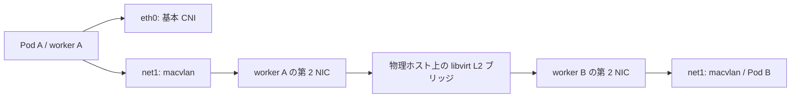

# Multus・macvlan・Whereabouts の設計と導入手順案

作成日: 2026-10-14。ユーザーの「weherbord」は Whereabouts を指すものとして整理した。今回は資料調査・設計のみで、クラスタ・VM の操作は行っていない。以下の導入コマンドと YAML はすべて未実行である。

## 前提と推奨構成

実環境の構成は [環境構成](environment.md)、台数・役割は [VM 一覧](vm-list.md)、現在の進捗は [検証状況](validation.md) を正本とする。既存記録の専用 L2 とワーカーの第 2 NIC を利用し、**Multus + macvlan（bridge モード）+ Whereabouts（Kubernetes backend）**を提案する。最初は VLAN タグ・ゲートウェイなしの IPv4 ワーカー間通信に限定する。

既存記録では Kubernetes 導入前までの準備が完了している。今回、稼働状況は再照会していない。基本 CNI の正常動作が導入条件であり、BCM での製品サポート・バージョン互換性を確認済みとは扱わない。

## 仕組みと役割

| 要素 | 役割 | 担当しないこと |
|---|---|---|
| 基本 CNI | Pod の eth0、通常のクラスタ通信 | 追加 L2 の IP 管理 |
| Multus | CNI 呼出しを仲介し、基本 CNI と NAD で指定した追加 CNI を実行 | 自身による L2 転送・IP プール管理 |
| macvlan CNI | ワーカーの親 NIC 上に Pod ごとの MAC を持つ net1 を作る | 複数ノードにまたがる IP の調停 |
| Whereabouts | 指定プールから IP を割当・解放し、共有状態でノード間の重複を防ぐ | DHCP サーバー、ルーター、外部機器の IP 台帳 |
| NetworkAttachmentDefinition（NAD） | 追加ネットワークの CNI 設定を保存する namespaced リソース | VM の NIC や libvirt ブリッジの作成 |

Pod 作成時、ランタイムから Multus が呼ばれ、基本 CNI に加え Pod annotation が指定した NAD の macvlan を実行する。macvlan は IPAM として Whereabouts を呼び出す。Whereabouts は Kubernetes API 経由で割当を管理し、結果の IP・経路が net1 に設定される。削除時の CNI DEL で解放する。Pod の既存ネットワークを annotation の編集だけで付け替える前提にせず、Pod 再作成で反映する。[Multus Usage](https://k8snetworkplumbingwg.github.io/multus-cni/docs/how-to-use.html)、[Whereabouts README](https://github.com/k8snetworkplumbingwg/whereabouts)。



これはデータの経路で、Multus / Whereabouts がパケットを中継するわけではない。同一ワーカー内の macvlan 同士は bridge モードで通信できる。`mode: bridge` は macvlan の動作モードであり、ゲスト内に Linux bridge を作る指示ではない。libvirt 側のブリッジとは別の層である。[macvlan CNI](https://www.cni.dev/plugins/current/main/macvlan/)。

## 設計時に決める項目

| 項目 | 今回の提案・導入前の確認 |
|---|---|
| 対象ノード | 第 2 NIC の存在と L2 接続を確認したワーカーのみ。専用 label と nodeSelector で Pod の配置を制限 |
| 親 NIC（master） | ゲスト内の NIC 名を MAC・libvirt 接続先と照合して指定。物理ホストのブリッジ名を指定しない。名前が異なる場合は統一または NAD と配置条件を分ける |
| 親 NIC の IP | macvlan の親に IPv4 アドレスは必須ではない。リンク UP と永続設定を用意し、不要な DHCP・デフォルト経路を追加しない |
| IP プール | 全ワーカー共通の範囲。管理・PXE・Pod CIDR・Service CIDR・到達先ネットワークと非重複。範囲・予約・最大 Pod 数と更新時の増分を環境文書で確定 |
| IPAM | Kubernetes backend。別途 etcd を立てず CRD に保存。通常の IPAM から始め、Fast IPAM は採用しない |
| 重複防止 | Whereabouts 管理外の固定 IP・DHCP 払出しとは自動調停されないため、台帳で分離・exclude 指定。同一 L2 では network_name / 保存 namespace を不用意に分けない |
| ルーティング | net1 は直結サブネットのみ。gateway、0.0.0.0/0、Multus の default-route 指定は初期案に入れない。クラスタ・DNS 通信は eth0 を維持 |
| MTU | 親 NIC、tap、libvirt ブリッジまで一致を確認。例の 1500 は未検証の候補。親より大きくしない |
| VLAN | 初期案は untagged。必要になればゲストの VLAN 親インターフェイスと仮想スイッチのタグ透過を別途設計。macvlan が VLAN を自動構成するとは扱わない |
| CNI 配置 | ランタイムの bin / conf dir と Multus・macvlan・Whereabouts の配置先、hostPath、設定参照先を一致させる。BCM 独自パスの有無を実機確認 |
| 導入版 | Kubernetes / 基本 CNI / CNI plugins / Multus / Whereabouts の版とイメージ digest を記録。公式 master / latest をそのまま本番適用しない |
| BCM 再展開 | 親 NIC の設定、プラグイン・設定ファイルの保持または再生成を BCM のイメージ・同期方針と整合。認証情報を共有イメージや Git にコピーしない |

Whereabouts は IP を永続的に特定 Pod へ予約する仕組みとしては扱わない。再作成時に同じ IP になる保証はない。`host-local` に同一のプールを各ワーカーへ設定する方式はノード間で割当を共有しないため、この設計の代替にはならない。異常停止では割当が残る場合があり、採用版の reconciler とその RBAC・動作周期を確認する。[Whereabouts README](https://github.com/k8snetworkplumbingwg/whereabouts)、[Extended configuration](https://github.com/k8snetworkplumbingwg/whereabouts/blob/master/doc/extended-configuration.md)。

### macvlan と仮想環境固有の制約

- **同じワーカーの親 NIC と、その配下の macvlan Pod は通常直接通信できない。** 親 NIC に IP を追加しても解消しない。初期試験は Pod 間通信とする。ノードとの追加ネットワーク通信が必要なら、ノード側 macvlan と予約 IP・経路を別途設計する。これは Linux の制約で、Docker のコマンドを Kubernetes へ流用するという意味ではない。[Docker の macvlan 制約説明](https://docs.docker.com/engine/network/drivers/macvlan/)。
- VM の 1 本の virtio NIC から複数の Pod MAC が送受信される。libvirt `filterref` / nwfilter、tap・ブリッジの転送と MAC 学習を調べる。VM 本来の MAC 以外を拒否するフィルターは通信を妨げ得る。全体のフィルターを一律に無効化せず、該当 NIC の必要条件を確認する。[libvirt Network Filters](https://libvirt.org/formatnwfilter.html)。
- 既存の専用 L2 は外部 uplink を持たない。外部通信が必要になれば、ルーター・戻り経路・許可範囲を追加設計する。Whereabouts の gateway 指定だけではルーターは生まれない。
- 通常の Service / DNS は自動的に net1 の IP を公開するものではない。アプリケーションの listen / bind、追加 IP の発見方法を決める。基本 CNI の NetworkPolicy が net1 にも効くとは仮定せず、NAD 利用権限と追加 L2 のアクセス制御を別途検証する。

## 導入手順案（すべて未実行）

### 1. 現状を確認して設計値を確定する

管理端末で正しい kubeconfig context を選び、読取り権限で確認する。設定内容には識別情報が含まれるため、原出力は Git 管理外へ保管する。

```bash
kubectl config current-context
kubectl version
kubectl get nodes -o wide
kubectl get pods -A -o wide
kubectl get daemonsets -A
kubectl get crd network-attachment-definitions.k8s.cni.cncf.io
```

期待結果: 対象ワーカーが Ready、基本 CNI が正常、既存 Multus / IPAM / Operator の有無を把握。CRD 未導入時の NotFound は記録する。既存の管理主体があるなら二重導入しない。

各ワーカーの OS で `ip -br link`、`ip -br addr`、`ip route`、`ip -d link show` を実行し、第 2 NIC と経路を確認する。ランタイムの実設定から CNI bin / conf dir を確認し、macvlan バイナリの有無と版を確認する。設定や kubeconfig 全文を公開ログに出さない。

物理ホストで libvirt の読取り権限を使い、次を実行する。`<WORKER_VM>` は各 VM 名へ置換するプレースホルダーであり、そのまま実行しない。

```bash
virsh domiflist '<WORKER_VM>'
virsh dumpxml '<WORKER_VM>'
virsh net-dumpxml tk8s-multus
bridge link show
bridge fdb show br tk8s-multus
```

期待結果: 第 2 NIC が専用 L2 に接続し、リンクが稼働、複数 MAC の転送を妨げる設定がない。稼働定義と永続定義の差も確認する。L2 の存在だけで疎通済みとはしない。

### 2. CNI 一式を導入する

クラスタ管理権限、ノード上のプラグイン配置権限が必要。以下は採用版を決めた後の順序である。

1. 既存の基本 CNI 設定とファイル所有者・配布元を記録し、管理者限定の場所にバックアップする。追加 NIC の UP 状態が再起動後も保たれるよう BCM 側の管理方式で設定する。
2. 対象ノードの実 CNI bin dir に、採用版の CNI plugins に含まれる macvlan を用意する。Multus 導入だけで全追加 CNI が配布されるとは仮定しない。
3. Multus の固定版 manifest を取得・レビューし、基本 CNI の委譲先・設定順、bin / conf dir、hostPath、対象ノードを調整する。thick を候補にし、既存の管理方式との整合で確定する。
4. Multus の CRD / RBAC / DaemonSet を導入し、対象ノードの Ready と、追加 annotation のない通常 Pod の eth0・DNS・Service 通信を確認する。
5. Whereabouts の同一固定版から IPPool / OverlappingRangeIPReservation の CRD、RBAC、インストール DaemonSet、reconciler を導入する。CRD Established を待って利用する。reconciler の配置形態は版により異なるため、その版の manifest を正本とする。
6. Whereabouts 共通設定の `datastore: kubernetes`、API 認証・到達性と CNI 実行時の設定パスを確認する。必要な全ワーカーにバイナリが存在し、reconciler が正常であることを確認する。

公式の導入元は [Multus Quickstart](https://k8snetworkplumbingwg.github.io/multus-cni/docs/quickstart.html) と [Whereabouts Installation](https://github.com/k8snetworkplumbingwg/whereabouts#installation)。マニフェストのファイル名・イメージ・CRD と設定互換性は採用タグで再確認する。未確定の版を実行可能な確定コマンドとして示さない。

### 3. NAD と試験 Pod を準備する

以下は独自に作成した**公開用の例示値**で、実測値・採用済み設定ではない。IP は文書用 `192.0.2.0/24`、親 NIC は仮名 `SECONDARY_NIC`。適用前に確定したネットワーク・NIC・MTU に置換する。例の `.100`～`.199` は 100 アドレスで、3 ワーカー合計の枠となる。ゲートウェイ・予約機器が必要なら払い出し範囲から除く。

`secondary-nad.yaml` の例:

```yaml
apiVersion: k8s.cni.cncf.io/v1
kind: NetworkAttachmentDefinition
metadata:
  name: secondary-macvlan
  namespace: multus-test
spec:
  config: |-
    {
      "cniVersion": "0.3.1",
      "name": "secondary-macvlan",
      "type": "macvlan",
      "master": "SECONDARY_NIC",
      "mode": "bridge",
      "mtu": 1500,
      "ipam": {
        "type": "whereabouts",
        "datastore": "kubernetes",
        "range": "192.0.2.0/24",
        "range_start": "192.0.2.100",
        "range_end": "192.0.2.199",
        "enable_overlapping_ranges": true
      }
    }
```

`cniVersion` は Kubernetes の版ではなく CNI 設定仕様の版で、採用する全プラグインの対応を確認する。Kubernetes 認証はインストーラーが用意する共通設定を利用する前提であり、NAD へ資格情報を埋め込まない。

`secondary-pod.yaml` の例。`WORKER_HOSTNAME_LABEL` を `kubernetes.io/hostname` の実値に、`TEST_IMAGE_AT_DIGEST` を承認した試験イメージへ置換する。イメージには `sleep`、`ip`、`ping`、DNS 照会・TCP 試験ツールを用意する。ping の権限も確認する。

```yaml
apiVersion: v1
kind: Pod
metadata:
  name: secondary-a
  namespace: multus-test
  annotations:
    k8s.v1.cni.cncf.io/networks: '[{"name":"secondary-macvlan","interface":"net1"}]'
spec:
  nodeSelector:
    secondary-network: "enabled"
    kubernetes.io/hostname: WORKER_HOSTNAME_LABEL
  containers:
    - name: tools
      image: TEST_IMAGE_AT_DIGEST
      command: ["sleep", "36000"]
  restartPolicy: Never
```

管理端末で以下を実行する計画。label は親 NIC とプラグインを確認した各ワーカーのみに付与する。`<WORKER_NODE>` は置換必須。試験用 namespace が既存なら用途を確認する。

```bash
kubectl label node '<WORKER_NODE>' secondary-network=enabled
kubectl create namespace multus-test
kubectl apply --dry-run=server -f secondary-nad.yaml
kubectl apply -f secondary-nad.yaml
kubectl apply -f secondary-pod.yaml
```

API の dry-run は NAD 内の CNI 設定の動作保証にはならない。同じ例から名前と配置先を変え、別ワーカーの `secondary-b` / `secondary-c` と、同一ワーカー比較用 Pod を作る。配置結果は必ず `kubectl get pods -n multus-test -o wide` で確認する。

### 4. 通信と割当を検証する

```bash
kubectl -n multus-test get pod secondary-a -o jsonpath='{.metadata.annotations.k8s\.v1\.cni\.cncf\.io/network-status}'
kubectl -n multus-test exec secondary-a -- ip -br addr
kubectl -n multus-test exec secondary-a -- ip route
kubectl -n multus-test exec secondary-a -- ping -I net1 -c 3 '<PEER_NET1_IP>'
kubectl get ippools.whereabouts.cni.cncf.io -A -o yaml
kubectl get overlappingrangeipreservations.whereabouts.cni.cncf.io -A
```

`<PEER_NET1_IP>` は相手 Pod の実際の追加 IP に置換する。`kubectl get pods -o wide` の通常の Pod IP と取り違えない。CR の原出力は識別情報を含むため Git に転載しない。

| 試験 | 合格条件 |
|---|---|
| NIC と経路 | eth0 と net1 が存在し、net1 は所定プール内。直結経路が net1、既存の default が維持される |
| 同一ノード・異なるノード | net1 を指定した ICMP と、net1 に bind した TCP サーバーへの通信が成功。3 ワーカーの全組合せで確認 |
| 一意性 | 同時稼働 Pod の net1 IP に重複なし。プールと予約情報が Pod の割当と一致 |
| 基本通信の回帰 | 導入前と同じ DNS・ClusterIP Service・必要な外部通信が eth0 経由で成功 |
| 削除・再作成 | 試験 Pod を通常削除し、割当解放を確認後に再作成して成功。同じ IP の再取得は合格条件にしない |
| 容量 | 必要 Pod 数 + 更新時の増加分 + 運用余裕がプールに収まる。枯渇試験は専用小規模プールで分離する |
| 再起動 | 後続の保守枠でワーカーを 1 台ずつ通常再起動し、親 NIC・CNI・新規 Pod の追加 NIC が復元することを確認 |

R-03 の判定・実行ログのリンクは [検証状況](validation.md) に集約する。今回はいずれも未実施。

### 5. 障害の切り分け・片付け

- `FailedCreatePodSandBox`: Pod の describe / events、Multus と kubelet のログを調べる。親 NIC 不在、プラグイン配置先、NAD namespace、Whereabouts の API / RBAC / プール枯渇を分ける。
- 同一ノードだけ通信可能: VM 間の L2、tap・ブリッジ、複数 MAC のフィルターを優先。必要時に対象を絞った ARP / ICMP キャプチャを行い、原本は公開しない。
- IP 割当成功でも通信不可: IPAM 成功は L2 成功を意味しない。送信元・宛先 IP と MAC、経路、MTU、アプリケーションの bind を調べる。
- API 障害時: 新規割当・解放が失敗し得る。既存 Pod の L2 転送と制御系の失敗を区別する。
- 異常停止後の割当残存: reconciler のログと Pod・sandbox の実在を照合する。停止不明のノードに生存 Pod が残る状態で IP を強制解放しない。必要なら先にノードを隔離して二重使用を防ぐ。
- 片付け: 試験 Pod を通常削除 → IP 解放確認 → 試験 NAD / namespace と今回専用 label の削除。共有 CNI の撤去は全利用 Pod と他 NAD の依存関係を確認してから行う。先に Whereabouts / CRD を消すと解放に必要な状態を失うため避ける。

## 出典と適用範囲

確認日: 2026-10-14。Web は当日表示の `current` / `master` と現行ドキュメントであり、リリースを固定した導入検証ではない。参照節は本文のリンクと次の表に示す。転載ではなく、本環境に合わせた設計案として整理した。

| 資料 | 参照箇所・扱い |
|---|---|
| `input/20-network/2026-09-22-network-notes.md` | 2026-09-22 利用者提供の専用 L2・追加 NIC・DHCP 不在。現在の状態を再確認したものではない。後続訂正を含む環境文書を正本とする |
| Multus Usage / Quickstart | Installation、NAD、Pod annotation、network-status。基本 CNI と追加 CNI の構成 |
| CNI macvlan current | Overview、Network configuration reference、Notes。master / mode / MTU |
| Whereabouts README master | Installation、Core Parameters、Overlapping Ranges、Network names、Known limitations |
| Whereabouts Extended configuration master | Kubernetes backend の共通設定・パス、IP Reconciliation。README と配置形態の表現差があるため採用タグで照合する |
| Docker macvlan / libvirt Network Filters | Linux macvlan のホスト通信制約 / MAC フィルターの仕組み。BCM の動作保証としては用いない |

## 今回の調査・文書作成の実施記録

実施日: 2026-10-14 JST（時刻未記録）。実行者: Codex。場所: リポジトリ作業端末。目的: 導入案の検討。権限: ローカル読取り・文書編集・Git、公開 Web 閲覧。使用ツール: Git 2.43.0、Python 3.12.3、シェルと Web ツール。対象製品の導入版は未定。ユーザーから今回のコマンド実行報告はない。

1. `pwd`、`rg --files`、`git status --short --untracked-files=all` で対象・文書・開始時の変更なしを確認した。
2. `cat` / `sed` / `rg` で AGENTS、README、環境・要件・VM 一覧・進捗・参考資料・導入前準備・保守手順と `.gitignore` を読んだ。広い一括表示が出力上限で省略されたため、関連箇所を絞って再読した。`rg --files --hidden --no-ignore input` で一次資料の所在を調べ、上記ネットワーク資料を読んだ。
3. Web 検索で Multus / macvlan / Whereabouts を探し、上記公式ドキュメントを開いて確認した。検索結果の第三者記事は設計根拠に採用していない。実環境への SSH・kubectl・virsh は未実行。
4. `git log -1 --format='%h %an <%ae>'` と保守記録から公開用名義を確認した。`git --version` / `python3 --version`、環境文書のパスワード欄がプレースホルダーであることを確認した。
5. シェル・Python で本書と README、環境・進捗・参考資料の関連リンクを更新した。環境の実測値は変更せず、提案と未確定事項を分離した。

証跡は今回のチャットのツール出力と Git 差分。期待成果は導入判断に必要な設計・未実行の手順・検証条件の保存であり、本書に反映した。残課題は採用版・実 NIC・IP 範囲・CNI パスの確定、BCM での永続化、実機試験である。

### 文書検証と公開情報チェック

6. Python で相対リンク・コードフェンスを確認した。最初の JSON 検証は抽出用正規表現が内側の閉じ括弧で止まり `JSONDecodeError` となった。抽出を YAML の config ブロック全体へ修正し、再実行でリンク・フェンス・NAD JSON・プール内の開始終了値と 100 アドレスを確認した。設定例自体の変更は不要だった。YAML の API 適合・実機疎通は未検証。
7. `git status --short --untracked-files=all`、`git diff --check`、`git ls-files -- input`、`git check-ignore -v -- input/20-network/2026-09-22-network-notes.md` を実行。対象は今回の 5 文書のみ、空白エラーなし、input 追跡なし、`/input/` により除外を確認した。
8. 最初の `git add` は `.git/index.lock` の作成が読取り専用制約で失敗（終了 128）。権限付きで同じ 5 文書を再ステージして成功した。`git diff --cached --name-status`、`git diff --cached --check`、`git diff --cached` で新規文書全文と変更差分・関連文脈を確認した。
9. 公開情報チェックは 5 文書のステージ内容、ファイル名、コミット文言と公開用名義を対象とした。新規 IP・NIC・接続先・イメージは例示値またはプレースホルダー、既存のネットワーク名は公開許可済みの範囲。認証実値・個人情報・第三者原本の混入なし、追加で除去すべき値なし、公開情報の未解決事項なし。この記録も再ステージして差分を再確認する。

コミットは既存の公開用名義 `Repository Maintainer <maintainer@example.invalid>` を明示してローカルに保存し、終了後に `git status --short` を確認する。push・初回公開・全履歴の公開監査は今回の対象外。コミット ID と残変更はチャットの完了報告に記載する。
